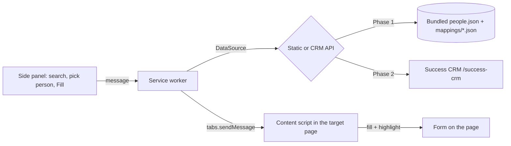

# PRD: ImmiFill Chrome Extension

Sep 26, 2026 · @a2

## Overview

ImmiFill is a Chrome MV3 extension in TypeScript that fills web forms, starting with Australian ImmiAccount visa forms, from Success CRM person records. The user reviews every filled page and submits it themselves. This PRD covers the extension only; the server side is in PRD: ImmiFill Backend — Success CRM Module.

**Delivery in two phases**

| Phase | Data | Goal |
| --- | --- | --- |
| Phase 1 | Bundled static JSON (people + mappings); no login, no network | Prove the fill engine works on several different sites |
| Phase 2 | Success CRM API (login, search, payload, mappings, audit) | Real data, behind the same `DataSource` interface |

**Goals**

- Phase 1: fill 100% of mapped fields correctly on 4 or more structurally different test sites, including a saved ImmiAccount page.
- Phase 2: switch from static to API data by changing only the data source, with no fill-engine changes.
- Zero silent mis-fills: every field ends as `filled`, `missing`, `not_found`, or `rejected`.
- Keep person data out of persistent browser storage.

**Non-goals (v1)**

- Auto-submitting, clicking Next, paying, or ticking declarations.
- Handling ImmiAccount login, MFA, or CAPTCHA.
- Document uploads.
- Firefox and Safari support (Chromium browsers only).

## Users and stories

The primary user is a migration agent or case officer filling applications for many people. In Phase 1 the developer is the user, testing the engine.

| Persona | Needs |
| --- | --- |
| Agent / case officer | Pick a person, fill the current page, review, move on |
| Admin | Create and fix field mappings when a form changes |
| Developer (Phase 1) | Run the extension against test sites with fake people and see exactly what filled and what didn't |

**User stories**

1. As a developer, I load the unpacked extension, pick a fake person from the side panel, and fill a test page with no backend running.
2. As a developer, I grant the extension access to a new site at runtime and fill it using that site's mapping.
3. As an agent, I search for a person (Lead, Student, Visa, and so on) and select one. In Phase 1 this searches the static list.
4. As an agent, I click **Fill this page** and see each field highlighted as filled, missing, not found, or rejected.
5. As an agent, I see which required values are missing before filling.
6. As an agent, I undo a page fill in one click.
7. As an admin, I use Record mode to click a field on the page and pick the value it should get, generating a mapping entry.

## Decisions

The key choice is a `DataSource` interface: the fill engine never knows whether data came from JSON files or the CRM.

| Decision | Choice | Why |
| --- | --- | --- |
| Data access | `DataSource` interface: `StaticDataSource` (Phase 1), `CrmApiDataSource` (Phase 2), selected by build flag `WXT_DATA_SOURCE=static\|api` | Phase 2 becomes a new class, not a rewrite |
| Value formatting | The server returns canonical values (ISO dates, country code + label). The extension formats each value per mapping field (`format`). | The same person fills different sites with different date and label formats |
| Mappings | Phase 1: bundled JSON per site. Phase 2: fetched from `/immifill/mappings` with ETag, and the bundled copy as fallback. | Fix broken forms without a Web Store release |
| Site access | Dev build: `optional_host_permissions: ["<all_urls>"]`, requested per site at runtime. Prod build: ImmiAccount + CRM API only. | Test on any site without shipping broad permissions |
| Auth | Phase 1: none. Phase 2: CRM `/auth/login`, token in `chrome.storage.session`. | Nothing to protect in Phase 1; test data is synthetic |
| Network calls | Service worker only, never the content script | MV3 content scripts are bound by the host page's CORS |
| Submission | Never automated | Legal and accuracy: the human attests to the declarations |

## Architecture

Three extension parts talk by messages. Only the service worker touches data, through whichever `DataSource` the build selected.



### DataSource contract

```ts
// lib/data/types.ts  (shapes match the backend PRD contract exactly)
export type EntityType = 'lead' | 'student' | 'education' | 'visa' | 'skill-assessment' | 'tribunal' | 'insurance';

export interface DataSource {
  login?(email: string, password: string): Promise<Session>;          // Phase 2 only
  search(type: EntityType, q: string, opts?: { order?: 'asc' | 'desc'; orderBy?: string; limit?: number }): Promise<PersonSummary[]>;
  getPayload(type: EntityType, id: number): Promise<ApplicantPayload>;
  listMappings(): Promise<MappingIndexEntry[]>;                         // { formKey, version, pageMatch }
  getMapping(formKey: string): Promise<FormMapping>;
  audit(entry: FillAudit): Promise<void>;
}
```

```ts
// lib/data/static.ts  (Phase 1)
import people from '@/data/people.json';
const mappings = import.meta.glob('@/data/mappings/*.json', { eager: true, import: 'default' });

export class StaticDataSource implements DataSource {
  async search(type, q, { order = 'asc', orderBy = 'firstName', limit = 25 } = {}) {
    const needle = q.trim().toLowerCase();
    return people
      .filter(p => p.personRef.type === type)
      .filter(p => !needle || `${p.name.given} ${p.name.family} ${p.contact.email}`.toLowerCase().includes(needle))
      .sort((a, b) => cmp(a, b, orderBy) * (order === 'asc' ? 1 : -1))
      .slice(0, limit)
      .map(toSummary);
  }
  async getPayload(type, id) {
    const p = people.find(p => p.personRef.type === type && p.personRef.id === id);
    if (!p) throw new NotFoundError();
    return ApplicantPayload.parse(structuredClone(p));   // same Zod validation as Phase 2
  }
  async listMappings() { return Object.values(mappings).map(m => pick(FormMapping.parse(m), ['formKey', 'version', 'pageMatch'])); }
  async getMapping(formKey) { return FormMapping.parse(Object.values(mappings).find(m => m.formKey === formKey)); }
  async audit(entry) { console.info('[immifill audit]', entry); } // counts only
}

// lib/data/index.ts
export const dataSource: DataSource =
  import.meta.env.WXT_DATA_SOURCE === 'api' ? new CrmApiDataSource(import.meta.env.WXT_CRM_BASE) : new StaticDataSource();
```

### Fill flow (both phases)

1. The side panel sends `FILL { type, personId }` to the service worker.
2. The service worker asks the active tab `DETECT_PAGE`. The content script matches `location.host`, the URL, and the heading against `listMappings()`, and returns a `formKey` or `null`.
3. The service worker loads `getMapping(formKey)` and `getPayload(type, personId)`.
4. It sends `FILL_PAGE { mapping, payload }` to the content script, which runs `fillPage` (see Extension spec) and returns a `FillReport`.
5. The side panel shows the report, and the service worker calls `audit()` with counts only.

### Value formatting

```ts
// lib/fill-engine/format.ts
import { format as fmt, parseISO } from 'date-fns';
export function formatValue(raw: unknown, field: FieldMapping): string | null {
  if (raw == null || raw === '') return null;
  if (field.type === 'date') return fmt(parseISO(String(raw)), field.format ?? 'dd MMM yyyy');  // ISO in, site format out
  return String(raw);
}
// Selects match an option by value first, then by case-insensitive trimmed label text.
```

### Phase 2: CrmApiDataSource

- `login()` posts to `{CRM}/auth/login` and stores `{ token, expiry, user }` in `chrome.storage.session`. A `chrome.alarms` timer logs out 60 seconds before `expiry`.
- Every call sends `authorization: <token>` with no `Bearer` prefix, as the CRM expects. Any 401 means logout.
- `search()` calls the existing list endpoints (`/lead`, `/student`, and so on) with `q`, `order`, `order_by` and `limit`, and maps `rows` to `PersonSummary`.
- `getPayload()`, `getMapping()`, `listMappings()` and `audit()` call `/immifill/*` routes from the backend PRD.
- All responses are parsed with the same Zod schemas as the static data, so contract drift fails loudly.

## Phase 1: static data and multi-site testing

Phase 1 ships with no backend: synthetic people and one mapping per test site are bundled in the extension. It is done when every fixture site fills with zero unexplained `not_found` or `rejected` fields.

### Static people (`data/people.json`)

Five synthetic people in the `ApplicantPayload` shape, each exercising a different edge case. No real client data is ever committed.

| Person | Type | Edge case covered |
| --- | --- | --- |
| Complete Applicant | lead | Every field present |
| Sparse Applicant | lead | Most fields null, so the pre-flight missing list is exercised |
| Long Name Applicant | student | Multi-word middle name, 40+ character family name, apostrophe and hyphen |
| Unicode Applicant | visa | Non-ASCII names (é, ñ, Devanagari), to check that the page accepts or rejects them visibly |
| Invalid Passport Applicant | skill-assessment | `passport.number: null` plus expired dates |

```json
{
  "personRef": { "type": "lead", "id": 1001 },
  "name": { "given": "Complete", "middle": "Test", "family": "Applicant" },
  "dob": "1994-03-15",
  "contact": { "email": "complete.applicant@example.test", "phone": "+61400000001" },
  "passport": { "number": "PA1234567", "issued": "2022-01-10", "expires": "2032-01-09" },
  "citizenship": { "code": "NPL", "label": "Nepal" },
  "currentVisa": { "type": "Student (500)", "expires": "2027-02-28" },
  "address": { "residential": "1 Test Street, Sydney NSW 2000" },
  "location": "Onshore",
  "employment": { "occupation": "Software Engineer" },
  "education": { "highest": "Bachelor of IT" },
  "serviceTypes": ["Visa"]
}
```

### Test sites

The fixtures are served locally by `pnpm fixtures` (Vite static server on `http://localhost:5174`). Each has its own mapping in `data/mappings/`.

| # | Site | What it proves |
| --- | --- | --- |
| 1 | `fixtures/plain.html`: plain inputs, select, radio, checkbox, text date | Basic handlers and events |
| 2 | `fixtures/postback.html`: choosing a country re-renders a dependent section after 500–1500 ms | `waitAfterMs` + `waitStable`, the ImmiAccount pattern |
| 3 | `fixtures/react.html`: React-controlled inputs (React from CDN) | The native-setter trick; values survive re-render |
| 4 | `fixtures/repeat.html`: "Add another address" button creates rows | `repeatGroup` handling |
| 5 | `fixtures/immi-saved/*.html`: ImmiAccount pages saved offline from a real session (scripts intact) | Real selectors and markup, with no live government system involved |
| 6 | A Google Form you own, on a real third-party domain | Runtime host permission, obfuscated markup, `fallbackLabel` matching |

Live ImmiAccount testing starts in Phase 2, with a real client's data and consent. Never put synthetic people into a live government application.

### Granting access to a new site (dev build)

```ts
// side panel: "Enable on this site" button
const [tab] = await chrome.tabs.query({ active: true, currentWindow: true });
const origin = new URL(tab.url!).origin + '/*';
const granted = await chrome.permissions.request({ origins: [origin] });
if (granted) {
  await chrome.scripting.executeScript({ target: { tabId: tab.id! }, files: ['content-scripts/content.js'] });
}
```

The dev manifest declares `"optional_host_permissions": ["<all_urls>"]` and the `scripting` permission. The prod manifest replaces this with fixed ImmiAccount and CRM hosts.

### Adding a mapping for a new site

1. Open the site, click **Enable on this site**, then switch on **Record mode**.
2. Click each field and pick the payload path (`name.given`, `dob`, and so on) from the dropdown. Record mode writes the selector, preferring `name`, then `id`, then label text.
3. Export the JSON to `data/mappings/<site>.json` and rebuild.

## Tech stack and repo layout

This is a single TypeScript repo for the extension; the backend lives in the CRM repo.

| Layer | Choice |
| --- | --- |
| Language | TypeScript 5.x, `strict: true` |
| Build | WXT (Vite-based, MV3), with `dev` and `prod` manifest variants |
| UI | Chrome Side Panel API + Preact |
| Validation | Zod: `ApplicantPayload`, `FormMapping`, `FillAudit` (same shapes as the backend contract) |
| Dates | date-fns |
| Tests | Vitest + jsdom (engine), Playwright with the unpacked extension (fixtures) |
| Package manager | pnpm |

```text
immifill-extension/
  entrypoints/
    background.ts          # service worker: message router, DataSource calls
    content.ts             # DETECT_PAGE / FILL_PAGE / RECORD handlers
    sidepanel/             # Preact: person search, Fill, report, Enable on this site, Record mode
  lib/
    data/                  # types.ts, static.ts, crm-api.ts (Phase 2), index.ts
    fill-engine/           # fillPage, setNative, waitStable, handlers, format, verify, undo
    schema/                # Zod schemas
    page-detect.ts         # host + URL + heading -> formKey
  data/
    people.json            # 5 synthetic people
    mappings/              # one JSON per test site
  fixtures/                # plain, postback, react, repeat, immi-saved/
  tests/
    unit/                  # engine + format + detect
    e2e/                   # Playwright: every person x every fixture
  wxt.config.ts            # manifest per mode; WXT_DATA_SOURCE, WXT_CRM_BASE
```

## Extension spec

The extension is a thin, deterministic executor. It holds no business logic, and applicant data lives only in service-worker memory for the duration of one fill.

### Components

| Component | Responsibility |
| --- | --- |
| Service worker (`background.ts`) | Message routing, DataSource calls, in-memory mapping cache; Phase 2: CRM login, expiry and 401 logout |
| Content script (`content.ts`) | Page detection (`formKey`), running the fill engine, field highlights, undo snapshot |
| Side panel | Sign-in, applicant search/select, Fill this page button, fill report, pre-flight missing-data list |

### Manifest essentials

```ts
// wxt.config.ts
export default defineConfig({
  manifest: ({ mode }) => ({
    name: 'ImmiFill',
    permissions: ['storage', 'sidePanel', 'activeTab', 'scripting', 'alarms'],
    ...(mode === 'development'
      ? { optional_host_permissions: ['<all_urls>'], host_permissions: ['http://localhost:5174/*'] }
      : { host_permissions: ['https://online.immi.gov.au/*', 'https://api.successedu.com.au/*'] }),
  }),
});
// content.ts declares matches per mode: localhost + ImmiAccount statically; other dev sites are injected at runtime.
```

Confirm the exact ImmiAccount host against the live site before the prod build. Use `chrome.storage.session` only for the Phase 2 token, never for person data.

### Mapping contract (packages/schema)

```ts
export const FieldMapping = z.object({
  path: z.string(),                         // dot path into ApplicantPayload, e.g. 'citizenship.label'
  selector: z.string(),                     // CSS; '{value}' token for radios
  fallbackLabel: z.string().optional(),     // match by <label> text if the selector misses
  type: z.enum(['text', 'select', 'radio', 'checkbox', 'date', 'textarea']),
  format: z.string().optional(),            // date-fns pattern for date fields, e.g. 'dd MMM yyyy', 'dd/MM/yyyy'
  waitAfterMs: z.number().int().max(5000).optional(),
  required: z.boolean().default(false),
  repeatGroup: z.string().optional(),       // e.g. 'addressHistory' -> clicks 'Add' per item
});

export const FormMapping = z.object({
  formKey: z.string(),
  version: z.number().int(),
  pageMatch: z.object({ host: z.string(), urlIncludes: z.string(), headingText: z.string() }),
  fields: z.array(FieldMapping),
});
```

### Fill engine

```ts
const protoFor = (el: Element) =>
  el instanceof HTMLSelectElement ? HTMLSelectElement.prototype
  : el instanceof HTMLTextAreaElement ? HTMLTextAreaElement.prototype
  : HTMLInputElement.prototype;

export function setNative(el: HTMLInputElement | HTMLSelectElement | HTMLTextAreaElement, v: string) {
  Object.getOwnPropertyDescriptor(protoFor(el), 'value')!.set!.call(el, v);
  for (const t of ['input', 'change', 'blur']) el.dispatchEvent(new Event(t, { bubbles: true }));
}

export const waitStable = (quietMs = 400, maxMs = 5000) => new Promise<void>((resolve) => {
  let quiet: number; const hard = setTimeout(done, maxMs);
  const obs = new MutationObserver(() => { clearTimeout(quiet); quiet = window.setTimeout(done, quietMs); });
  function done() { obs.disconnect(); clearTimeout(hard); resolve(); }
  obs.observe(document.body, { childList: true, subtree: true, attributes: true });
  quiet = window.setTimeout(done, quietMs);
});

export async function fillPage(m: FormMapping, data: ApplicantPayload): Promise<FillReport> {
  const snapshot = captureValues(m);          // for one-click undo
  const results: FieldResult[] = [];
  for (const f of m.fields) {
    const value = formatValue(get(data, f.path), f);   // ISO -> site format
    if (value == null || value === '') { results.push({ path: f.path, status: 'missing' }); continue; }
    const el = resolve(f, String(value));      // selector, then fallbackLabel
    if (!el) { results.push({ path: f.path, status: 'not_found' }); continue; }
    await handlers[f.type](el, String(value));
    if (!verify(el, f, String(value))) { results.push({ path: f.path, status: 'rejected' }); continue; }
    highlight(el, 'filled');
    results.push({ path: f.path, status: 'filled' });
    if (f.waitAfterMs) await waitStable(400, f.waitAfterMs);
  }
  return { formKey: m.formKey, mappingVersion: m.version, results, snapshot };
}
```

### Behaviour rules

- Never click Next, Submit, Pay, or any declaration checkbox.
- Fill fields in mapping order, because dependent selects re-render sections.
- Read the value back after each write (`verify`); if the page reformats or rejects it, report `rejected`.
- Pre-flight: before filling, list `required` fields that are missing in the payload.
- Undo restores the snapshot captured before the fill.
- If the page doesn't match any mapping, show "Unsupported page" and do nothing.

## Security and privacy

Phase 1 holds only synthetic data. The Phase 2 rules below still apply from day one, so nothing needs retrofitting.

- **Data:** person payloads live only in service-worker memory for one fill and are cleared afterwards or after 60 seconds. They are never written to `chrome.storage`, logs, or the console. Audit entries carry counts only.
- **Repo hygiene:** `data/people.json` holds synthetic people only. A CI check fails if it contains real-looking passport numbers or non-`example.test` emails.
- **Token (Phase 2):** kept in `chrome.storage.session` only. It is cleared on logout, at expiry, and on any 401. The password is never stored.
- **Permissions:** the dev build uses runtime per-site grants; the prod build uses fixed hosts only. Dev builds are never published to the Web Store.
- **Code:** default MV3 CSP, with no `eval`, no remote code, and no `innerHTML` from data. Mappings are data only and are Zod-validated before use.
- **Behaviour:** the extension never clicks Next, Submit, Pay, or declarations, and never touches CAPTCHA or MFA.
- **Compliance (before Phase 2 pilot):** review the ImmiAccount terms of use on automated tools, the Australian Privacy Act / APPs, and the OMARA Code of Conduct if users are registered migration agents.

## Testing, milestones and acceptance

Phase 1 takes about 2 weeks and needs no backend. Phase 2 starts once the backend PRD's routes are live in staging.

**Testing**

- Unit tests (Vitest + jsdom): each field handler, `formatValue` for several date patterns, select matching by value and by label, `verify`, undo, and page detection.
- E2E tests (Playwright, unpacked dev build): the full matrix of 5 people × fixture sites 1–5. Each run asserts the final value of every mapped field and the report status.
- Manual: fixture site 6 (your Google Form), plus Record mode on a new site.
- CI (GitHub Actions): typecheck, lint, unit, E2E, and the synthetic-data check on every PR. Tag `ext-v*` to build the prod zip.

| Milestone | Scope | Exit criteria |
| --- | --- | --- |
| P1a (week 1) | WXT scaffold, schemas, `StaticDataSource`, side panel search + Fill, fixtures 1–3 | E2E green on fixtures 1–3 |
| P1b (week 2) | Fixtures 4–6, Record mode, runtime site grants, undo, pre-flight | Full matrix green; site 6 fills manually |
| P2 (weeks 3–4) | `CrmApiDataSource`, login, live mappings with fallback, audit | Same E2E suite passes with `WXT_DATA_SOURCE=api` against staging |
| P3 | Prod build, live ImmiAccount with a real client (with consent), pilot with 3–5 agents | Pilot hits the Overview goals; compliance sign-off |

**Acceptance criteria (Phase 1)**

- [ ] With the backend off, the extension searches, fills and reports using only bundled data.
- [ ] Every mapped field ends as `filled`, `missing`, `not_found`, or `rejected`, with no silent writes.
- [ ] Dates render in each mapping's `format`; selects match by value or label.
- [ ] Postback and React fixtures keep filled values after re-render.
- [ ] A new site can be enabled at runtime and mapped with Record mode without editing code.
- [ ] The extension never triggers navigation or submission.
- [ ] Switching `WXT_DATA_SOURCE` touches no fill-engine code.

**Risks**

| Risk | Mitigation |
| --- | --- |
| ImmiAccount DOM changes | Remote mappings in Phase 2, `fallbackLabel`, a refresh routine for saved fixtures |
| Static data shape drifts from the real API | Both sides use the same contract; the Zod parse runs in both data sources |
| Sites that block synthetic events | Verify after each write, report `rejected`, never retry blindly |

**Open questions**

- [ ] Which ImmiAccount pages and visa subclass to save as fixtures first?
- [ ] Is Record mode needed in Phase 1, or can mappings be hand-written for the first sites?
- [ ] Which extra public site should be the second real-domain test besides the Google Form?
